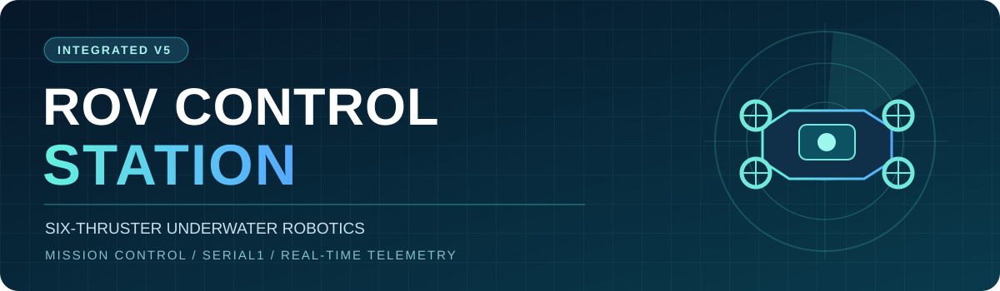
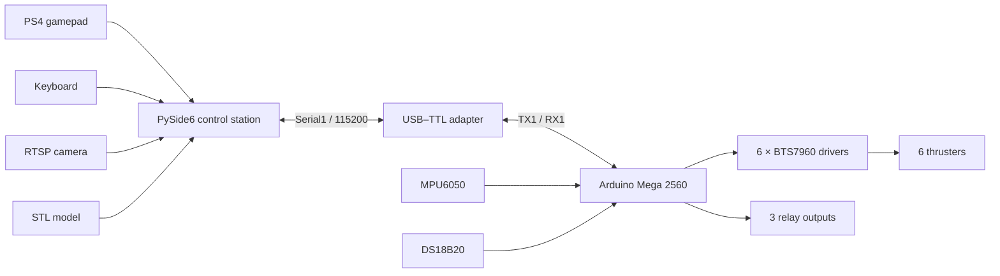

<div align="center">



<br />

# MESEKET Control Station — Mars Rover & ROV

**A unified PySide6 mission-control desktop application with dedicated Mars Rover (ROS 2) and Underwater ROV (Arduino Mega V5) sections.**

*Mars Rover ROS 2 telemetry & Nav2 · 6-thruster ROV Serial1 V5 · RTSP & ROS cameras · Motor test stations · Live sensors · 3D STL*

<br />

[](https://www.python.org/)
[](https://doc.qt.io/qtforpython-6/)
[](#mars-rover-section)
[](#rov-section)
[](#communication-protocol)

[-16845B?style=flat-square)](#testing--project-status)
[](#thruster-map)
[](#vehicle-selector)
[](https://github.com/Muhammad-296)

**[Vehicle selector](#vehicle-selector)** · **[Mars Rover section](#mars-rover-section)** · **[ROV section](#rov-section)** · **[Project layout](#project-layout)** · **[Architecture](docs/ARCHITECTURE.md)** · **[Troubleshooting](docs/TROUBLESHOOTING.md)**

</div>

---

## Two vehicle sections

The application boots into a unified vehicle selector (`control_station.py`) supporting two independent control stations with separate settings, safety states, and hardware interfaces:

| Vehicle section | Target stack & capabilities | Entry point |
| :-- | :-- | :-- |
| 🔴 **[Mars Rover section](#mars-rover-section)** | ROS 2 telemetry, 4WD/4WS kinematics & trajectory preview, interactive 2D SLAM/Nav2 map with ArUco & 3D obstacles, ROS/RTSP cameras, 8-channel Motor Test Station, diagnostics, unified CSV black-box, and gated `/cmd_vel` + `/goal_pose` | `control_station.py` → **Mars Rover** |
| 🔵 **[ROV section](#rov-section)** | Original 6-thruster underwater ROV control, Arduino Mega 2560 Serial1 V5 protocol, PS4 gamepad mixing, direct RTSP camera, MPU6050 IMU, DS18B20 water temperature, and 3D STL viewer | `control_station.py` → **ROV** *(or standalone `ROV_Control_Station_Integrated.py`)* |

---

## Vehicle selector

Launch `python control_station.py`, `RUN_GUI.bat` on Windows, or `./RUN_GUI.sh` on Ubuntu, then choose **Mars Rover** or **ROV**. The launcher also displays live environment dependency badges (`PySide6`, `OpenCV`, `Pygame`, `VTK 3D`, `ROS 2`).

The selector and offline Rover dashboard require only PySide6:

```bash
python -m pip install "PySide6>=6.7,!=6.12.0,<7"
python control_station.py
```

On Ubuntu, use `python3` in an activated virtual environment. If Python 3.10/3.11 exits with `none_dealloc: deallocating None`, verify the PySide6 version—version `6.12.0` has a reference-counting defect and is excluded from `requirements.txt`. Create a virtual environment with the known working `6.11.2` release:

```bash
python3 -m venv --system-site-packages .venv
.venv/bin/python -m pip install "PySide6==6.11.2"
./RUN_GUI.sh
```

Using `--system-site-packages` exposes existing ROS 2 and system dependencies without modifying global Python packages. Closing either vehicle window returns cleanly to the selector; the standalone ROV entry point, `START_ROV_*` scripts, firmware, and Windows EXE build scripts remain ROV-only and unchanged.

---

## Mars Rover section

The **Mars Rover section** adapts the control station layout with a Mars red theme: top ROS 2 connection and safety bar, left manual/steering panel, centre drive/map/motor/sensor tabs, right tuning/camera/network/ROS settings, and a bottom filterable log.

It includes an animated 4WD/4WS rover schematic, 2D SLAM/Nav2 map with ArUco and obstacle overlays, four drive motors (`D1–D4`), four steering motors (`S1–S4`), four drive encoder rows (`E1–E4`), unified ROS/RTSP camera streaming, Motor Test Station with guided 8-motor bench inspection, PS4 monitor, ROS diagnostics, and an optional 3D STL viewer (VTK). Simulation and Hardware profiles keep separate ROS topic settings. Steering encoder feedback remains deferred and is marked **Not implemented** until a hardware ROS interface publishes it.

| Wheel | Drive / encoder | Steering (feedback deferred) |
| :-- | :-- | :-- |
| Front left | D1 / E1 | S1 |
| Front right | D2 / E2 | S2 |
| Rear left | D3 / E3 | S3 |
| Rear right | D4 / E4 | S4 |

### Standalone Gazebo teleop (Control Phase 1)

The autonomous project's `Autonmous_Ws/Control/README.md` and `CONTROL_PLAN.md` define the GUI-first rollout, followed by command arbitration, Jetson/CAN/STM32 control, payloads, and later steering.

With the existing simulator and `teleop_guard.py` running in a compatible ROS environment, open this GUI directly with:

```bash
.venv/bin/python control_station.py --gazebo-teleop
```

This session-only profile uses measured `/joint_states_gz` RPM, `/imu/data`, Gazebo `/odom`, `/camera/image_raw`, and `/camera/depth/image_raw`. Manual commands go to `/cmd_vel_manual`; the Control guard alone forwards bounded commands to `/cmd_vel` and stops on timeout. The GUI also zeros setpoints if UI updates stop. Start disconnected/disarmed, press CONNECT ROS 2, select ROS Teleop output, and ARM. Under Camera, select ROS RGB or Depth and Connect.

The existing Gazebo rover is skid-steer: wheel angles stay fixed and steering-mode selection is disabled. Navigation, maps, perception, slip diagnostics, steering feedback and payload controls are not launched in this session. Individual motor-test inputs remain local preview; they do not drive single Gazebo motors. Do not run Nav2 or another teleop publisher in this standalone session. Saved topic profiles remain unchanged.

The recommended host launcher is `Autonmous_Ws/Control/scripts/run_gui_docker.sh` in the autonomous project. It runs both applications in Jazzy/Harmonic, using the dedicated GUI image and read-only source mounts. `run_gui_teleop.sh` is the entry point inside that environment. The host's Humble/Fortress installation is not used for the combined session.

### ROS 2 connection & safety gating

Start the GUI from a terminal with ROS 2 sourced and a matching Python interpreter (`rclpy` + PySide6):

```bash
source /opt/ros/jazzy/setup.bash   # or /opt/ros/humble/setup.bash
python3 control_station.py
```

Select **Mars Rover**, choose **Simulation** or **Hardware** under the **ROS** tab, then press **CONNECT ROS 2**.

- **Preview Only (Safe, default):** zero ROS command publishers active; keyboard/gamepad/test inputs animate only the local GUI.
- **ROS 2 Teleop (`/cmd_vel`):** switching **OUTPUT** to ROS 2 Teleop requires an active ROS 2 connection and explicit **ARM** before publishing `/cmd_vel` (`geometry_msgs/msg/Twist`) or `/goal_pose` (`geometry_msgs/msg/PoseStamped`).
- **E-STOP & Watchdogs:** pressing **■ E-STOP** (or `Space` / `Esc`) immediately emits a zero-velocity burst, cancels any waypoint mission, and latches outputs until **RESET LATCH** is pressed.

### Rover ROS 2 topic contracts

| Subsystem | Default Topic (Simulation / Hardware) | Message Type | Purpose |
| :-- | :-- | :-- | :-- |
| Drive joint states | `/joint_states_gz` / `/joint_states` | `sensor_msgs/msg/JointState` | Joint rad/s → RPM (or position differentiation) |
| Drive ticks | `/wheel/ticks` or `/wheel/ticks/{wheel}` | `std_msgs/msg/Int64MultiArray` / `Int64` | Raw encoder tick counts (`FL, FR, RL, RR`) |
| Wheel speeds | `/wheel/per_wheel_speeds` | `std_msgs/msg/Float64MultiArray` | Wheel linear speeds (m/s) → RPM |
| Orientation / IMU | `/imu/data` | `sensor_msgs/msg/Imu` | Attitude, gyro (°/s), accel (g) |
| EKF Pose & Speed | `/odometry/filtered` | `nav_msgs/msg/Odometry` | Rover `(X, Y, Yaw)` and speed (m/s) |
| Wheel Odometry | `/odom` / `/wheel/odom_raw` | `nav_msgs/msg/Odometry` | Raw simulation or wheel encoder odometry |
| Slip monitor | `/wheel/slip_detected`, `/wheel/single_wheel_slip` | `std_msgs/msg/Bool` | Slip warning indicators |
| SLAM Map & Nav2 Plan | `/map`, `/plan` | `OccupancyGrid`, `Path` | Live 2D map and global route |
| Perception | `/perception/aruco_pose`, `/perception/obstacles_only` | `PoseStamped`, `Detection3DArray` | Landmark and 3D obstacle map overlays |
| Cameras | `/camera/image_raw`, `/camera/depth/image_raw`, `/marker_detection/*` | `sensor_msgs/msg/Image` | On-demand RGB, colorized depth, and ArUco debug feeds |
| Diagnostics | `/slam/encoder_diagnostics`, `/slam/slip_diagnostics` | `diagnostic_msgs/msg/DiagnosticArray` | Node health and topic Hz rates |
| Gated Commands | `/cmd_vel`, `/goal_pose` | `Twist`, `PoseStamped` | Published only when ARMED in ROS 2 Teleop mode |

### Rover operator features

- **Manual / Joystick:** `W/S` drive, `A/D` steer, `Q/E` turn, `Space` / `Esc` stop; supports Coordinated, Crab, and Turn-in-Place 4WS kinematics with predicted trajectory arc/vectors.
- **Navigation / Map:** interactive zoom/pan 2D SLAM map, Follow Rover mode, waypoint queue with JSON save/load and auto-advance when armed.
- **Motor Test Station:** detached window (`1–4` drive, `5–8` steering preview) with common sliders, reverse toggle, live RPM readouts, and an 8-step guided inspection checklist with CSV export.
- **Camera:** unified switcher between ROS 2 RGB, colorized Depth heatmap, ArUco/Pose debug images, and Direct RTSP (anonymous or authenticated; never auto-connects on view toggle) with detached fullscreen monitor (`F11`) and PNG snapshots.
- **Sensors & Telemetry Black-Box:** live 3-column IMU HUD with **Zero yaw**, Subsystem Health Matrix, topic Hz monitor + ROS graph scan, and unified telemetry CSV recording (pose, IMU, 4-wheel ticks/RPM, slip state).

```bash
# Rover & selector verification
.venv/bin/python -m py_compile *.py
QT_QPA_PLATFORM=offscreen .venv/bin/python test_rover_gui.py
```

---

## ROV section

### Mission overview

The **ROV section** (`ROV_Control_Station_Integrated.py`) brings the underwater operator interface, Arduino Mega 2560 firmware, six BTS7960 thruster drivers, sensor data, RTSP camera streaming, and motor verification into one coordinated system. The desktop controller is built with **Python + PySide6**; real-time commands are handled by **Arduino Serial1 at 115200 baud**.

> [!NOTE]
> **Hardware status:** The project owner reports that the ROV system has been **tested with physical hardware**. Exact test conditions, acceptance criteria, duration, and underwater qualification have not been supplied. The software includes simulated protocol tests, but neither those tests nor the owner-reported hardware testing imply safety certification.

<div align="center">

<br />
<sub>Original animated project graphic — illustrative; not live sonar data or a GUI recording.</sub>
</div>

### Capabilities

| Module | What it delivers |
| :-- | :-- |
| 🎮 **Pilot controls** | PS4 gamepad and keyboard-driven ROV control with 5-degree-of-freedom thruster mixing |
| ⚙️ **Advanced motor testing** | Dedicated non-modal test window; momentary keys **1–6**, per-motor speed, inversion, and command acknowledgements |
| 📷 **Video feed** | RTSP preview, independent camera window, configurable stream profile/transport, fullscreen and snapshots |
| 🧭 **Attitude & telemetry** | MPU6050 IMU visualization, DS18B20 water temperature, commanded PWM feedback and CSV logging |
| 🧊 **3D model view** | STL viewer and simulated orientation/movement visualization; **not** underwater position tracking |
| 🛡️ **Safety controls** | Firmware-authoritative arm/disarm, latched E-STOP / FAILSAFE, mode separation, active motor-test watchdog |
| 🧰 **Developer tools** | Versioned serial protocol, Python protocol test, Windows installer/launcher and PyInstaller build scripts |

### System architecture



> The architecture diagram shows intended component connections, not proof of validated electrical wiring. Match the firmware pin map to your assembled system.

### Engineering resources & continuous integration

[](https://github.com/Muhammad-296/ROV-Control-Station/actions/workflows/python-checks.yml)
[](https://github.com/Muhammad-296/ROV-Control-Station/actions/workflows/arduino-compile.yml)

> Status badges report automated workflow results **after** GitHub Actions has run. Passing automation is not evidence of successful hardware operation.

| Resource | Description |
|:--|:--|
| [Architecture](docs/ARCHITECTURE.md) | Mermaid block, communications and safety state diagrams, editable in GitHub Markdown |
| [Engineering guide](docs/ENGINEERING_GUIDE.md) | Components, signal wiring, firmware and GUI responsibilities, calibration, operations |
| [Serial protocol](docs/PROTOCOL.md) | V5 messages, mode rules, acknowledgments and telemetry |
| [Hardware validation](docs/HARDWARE_VALIDATION.md) | Owner-reported testing with blank, reproducible acceptance records |
| [Troubleshooting](docs/TROUBLESHOOTING.md) | Connection, motor, telemetry, camera and build diagnostics |
| [CI guide](docs/CI_GUIDE.md) | What the Python and Arduino workflows verify—and what they cannot |

### Quick start (ROV)

#### 1 — Requirements

- **Windows + Python 3.12** for the documented standalone ROV workflow.
- Arduino Mega 2560 and the matching **V5 firmware**.
- Six BTS7960 motor drivers and wired thrusters for hardware operation.
- Serial1 USB–TTL adapter, compatible signal levels, shared ground, and a **separate physical motor power disconnect**.
- Optional PS4 controller, RTSP camera, MPU6050, DS18B20, and STL asset.

#### 2 — Install & launch the desktop GUI

Run PowerShell in the repository root:

```powershell
py -3.12 -m venv .venv
.\.venv\Scripts\python.exe -m pip install --upgrade pip
.\.venv\Scripts\python.exe -m pip install -r requirements.txt
.\.venv\Scripts\python.exe ROV_Control_Station_Integrated.py
```

Alternatively, launch via `control_station.py`, use `INSTALL_WINDOWS.ps1` followed by `RUN_GUI.bat`, or run `START_ROV_WINDOWS.bat`.

> [!TIP]
> Keep the build environment **PySide6-only**. Installing PyQt6 into the same virtual environment can cause PyInstaller to abort due to competing Qt bindings.

#### 3 — Flash matching Arduino firmware

1. Install **OneWire** and **DallasTemperature** in Arduino IDE; `Wire` is included with the Arduino platform.
2. Open [`ROV_Mega_Integrated/ROV_Mega_Integrated.ino`](ROV_Mega_Integrated/ROV_Mega_Integrated.ino).
3. Select **Arduino Mega or Mega 2560** and upload via the Mega's **programming USB** with motor load power disconnected.
4. Connect the USB–TTL adapter to **Serial1**, and choose its COM port in the GUI at **115200 baud**.
5. Verify the GUI receives `SYS:HELLO,5,ROV_MEGA6` before attempting to arm.

**GUI V5 and firmware V5 must be used together.** Previous protocol versions are not interchangeable.

#### 4 — Build the Windows executable (optional)

Use `BUILD_EXE.ps1` after installing dependencies, or inspect `BUILD_ROV_EXE.bat` for its build workflow. PyInstaller output is placed under `dist/` when successful. A prebuilt `.exe` is **not included** in this source repository. Local executable builds should be verified on the destination Windows system.

### Hardware & wiring

#### Thruster map

| Thruster | Position | RPWM | LPWM | R_EN | L_EN |
| :-- | :-- | --: | --: | --: | --: |
| **M0** | Front left | `2` | `3` | `23` | `25` |
| **M1** | Front right | `4` | `5` | `27` | `29` |
| **M2** | Rear left | `6` | `7` | `31` | `33` |
| **M3** | Rear right | `8` | `9` | `35` | `37` |
| **M4** | Vertical left | `10` | `11` | `39` | `41` |
| **M5** | Vertical right | `12` | `13` | `43` | `45` |

These are the **V5 firmware mappings**, not a guarantee of your real-world motor orientation. Confirm polarity and position against the physical assembly.

#### Peripherals

| Peripheral | Mega 2560 connection | Notes |
| :-- | :-- | :-- |
| CP2102/USB–TTL adapter | TXD → `D19/RX1`; RXD ← `D18/TX1`; GND ↔ GND | Level-shift/protect adapter RX if it is not 5 V tolerant |
| MPU6050 | SDA `D20`, SCL `D21` | I²C |
| DS18B20 | Data `A15` | 4.7 kΩ pull-up to 5 V (per supplied design) |
| Relay channels | `D17`, `D16`, `D15` | Check active polarity and safe de-energized state |

**Never power the motor drivers from the Arduino signal pins.** Supply motor power independently and ensure appropriate power distribution, fusing, wire sizing, and grounding.

### Motor Test Station (ROV)

The V5 release includes an **independent, non-modal Motor Test Station**, sharing the dashboard's verified COM connection. It isolates direct motor tests from normal drive controls.

| Action | Input |
| :-- | :-- |
| Select a motor | Hold **`1`–`6`** to command M0–M5 respectively |
| Stop selected motor | Release its key or on-screen hold button |
| Stop and disarm | **Space** |
| Latched emergency stop | **Esc** |
| Adjust motor power | Per-motor slider **5–60%**, common slider |
| Reverse direction | Reverse option or saved per-motor inversion |

**Typical procedure:** secure the ROV, remove propellers, verify the physical E-STOP, confirm firmware handshake, select Motor Test while **disarmed**, open the test window, explicitly **arm**, and test one motor briefly at low power. Closing or unfocusing the test station triggers stop behavior, and closing it disarms.

Safeguards in this mode include **single-motor command enforcement**, an active-test **225 ms packet watchdog**, an **8-second continuous-test limit**, and `MT:ACK` tracking. These limits are software/firmware defenses, not physical measurements or a substitute for emergency power isolation.

### Communication protocol

Text-based Serial1, **115200 baud**, newline-delimited, **protocol V5**.

| PC → firmware | Expected reply or action |
| :-- | :-- |
| `SYS,HELLO,5` | `SYS:HELLO,5,ROV_MEGA6` |
| `PING` | `PONG` (connectivity only) |
| `SYS,MODE,DRIVE` | Set DRIVE when disarmed |
| `SYS,MODE,INDIVIDUAL` | Set test mode when disarmed |
| `SYS,ARM` / `SYS,DISARM` | Request an authorized arm / disarm |
| `MT,1,0,15` | Request motor M0 at +15%; expect `MT:ACK,1,0,15` |
| `MT,2,-1,0` | Request immediate zero motor-test outputs |
| `SYS,ESTOP` / `SYS,RESET` | Latch stop / explicitly clear the latch when permitted |
| `V 20 0 0 0 0` | Example drive packet (DRIVE mode only) |

> [!IMPORTANT]
> An ACK reports **firmware command acceptance**, not physical RPM or thrust. PWM telemetry indicates commanded output, not measured electrical or mechanical feedback.

---

## Project layout

```text
ROV-Control-Station/
├── README.md                            # Project documentation (Mars Rover + ROV)
├── control_station.py                   # Unified Vehicle Selector (Mars Rover / ROV)
├── rover_dashboard.py                   # Mars Rover PySide6 control station
├── rover_kinematics.py                  # 4WD/4WS kinematics, Twist mapping & SafetyController
├── rover_ros.py                         # ROS 2 telemetry, cameras, diagnostics & gated pubs
├── rover_map.py                         # Interactive 2D SLAM/Nav2 map & waypoint mission runner
├── rover_camera.py                      # Unified ROS 2 Image + Direct RTSP camera manager
├── rover_view.py                        # Animated 4WD/4WS rover schematic & alert HUD
├── rover_theme.py                       # Mars red stylesheet & selector card styling
├── ROV_Control_Station_Integrated.py    # Original ROV PySide6 desktop application
├── ROV_Mega_Integrated/
│   └── ROV_Mega_Integrated.ino          # Matching Mega firmware V5 (ROV)
├── assets/
│   ├── rov-banner.svg                   # Designed GitHub banner
│   └── rov-sonar.gif                    # Original animated visual
├── models/
│   └── ROV Assembly_Fully.STL           # 3D model
├── docs/                                # Architecture, protocol, CI & validation guides
├── .github/workflows/                   # Automated Python & Arduino CI checks
├── requirements.txt
├── test_protocol.py                     # ROV synthetic protocol checks
├── test_rover_gui.py                    # Mars Rover unit, ROS parser & offscreen Qt tests
├── INSTALL_WINDOWS.ps1                  # Windows dependency setup
├── RUN_GUI.bat                          # Windows selector launcher
├── RUN_GUI.sh                           # Ubuntu selector launcher
├── BUILD_EXE.ps1                        # PyInstaller build helper (ROV)
├── BUILD_ROV_EXE.bat
├── START_ROV_WINDOWS.bat
├── START_ROV_MAC.command                # Optional; not independently verified
└── .gitignore
```

## Testing & project status

| Area | Current status |
| :-- | :-- |
| **ROV physical hardware operation** | **Tested — as confirmed by the project owner** |
| **Mars Rover software & ROS parsers** | **Unit, mock ROS & offscreen Qt tests included (`test_rover_gui.py`)** |
| **Desktop Python syntax** | Checked with `py_compile` across all `.py` files |
| **ROV protocol/state behavior** | Synthetic tests included (`test_protocol.py`) |
| **Live field endurance & waterproofing** | Not documented in this repository |
| **Independent safety certification** | Not claimed |

Run all software checks locally:

```bash
# Ubuntu / Linux (.venv)
.venv/bin/python -m py_compile *.py
.venv/bin/python test_protocol.py
QT_QPA_PLATFORM=offscreen .venv/bin/python test_rover_gui.py
```

```powershell
# Windows
py -3.12 -m py_compile *.py
py -3.12 test_protocol.py
py -3.12 test_rover_gui.py
```

Hardware evidence (photos, videos, test logs, acceptance metrics) can be added later to document field testing. No such evidence is implied by this README.

## Safety notice

> [!CAUTION]
> ROV thrusters and Mars Rover drive/steering actuators can injure people or damage equipment. **Remove propellers / place the rover on blocks for bench tests**, secure the assembly, use a current-limited supply where practical, install an **independent hardwired power cutoff**, check the driver power wiring and ground references, and confirm relay polarity. **Software E-STOP does not physically isolate motor power**, and zero PWM or zero `/cmd_vel` does not guarantee immediate mechanical stop. Perform separate electrical and environmental safety assessments before field or underwater operation.

## Release history

| Version | Highlight | Details |
| :-- | :-- | :-- |
| **V3** | Independent motor mode, mode handshake | [Changelog](docs/CHANGES_V3.md) |
| **V4** | Dedicated keyboard motor-test mode | [Changelog](docs/CHANGES_V4.md) |
| **V5** | Separate Motor Test Station, ACKs and watchdog | [Changelog](docs/CHANGES_V5.md) |
| **Mars Rover** | Unified Vehicle Selector + ROS 2 Mars Rover Control Station | [Mars Rover section](#mars-rover-section) |

## Credits & licensing

**Maintainer:** [Muhammad-296](https://github.com/Muhammad-296) · **Project:** MESEKET Control Station (Mars Rover & ROV) · **Stack:** Python / PySide6 / ROS 2 / Arduino / VTK / OpenCV / pygame.

The GUI source includes attribution for a DualShock 4 photograph by **ITEagle Europe / Sebastiaan Broekhoven**, licensed **CC BY-SA 4.0**; refer to the GUI source header for the original link and requirements.

**Project license:** No repository-wide license has been declared. Unless the owner adds one, this repository should not be treated as granting open-source reuse rights.

<div align="center">

---

**ENGINEERED FOR OBSERVABILITY · BUILT FOR CONTROL · MARS ROVER & ROV**

[Back to top ↑](#meseket-control-station--mars-rover--rov)

</div>
