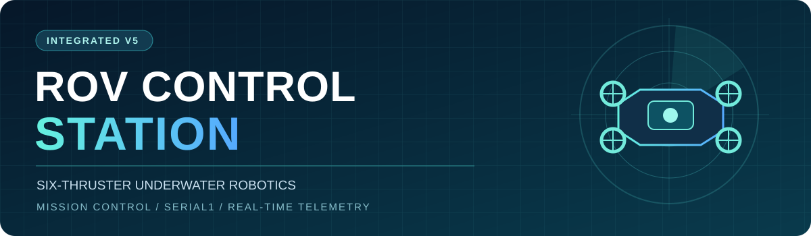
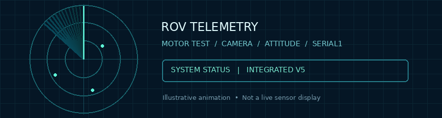
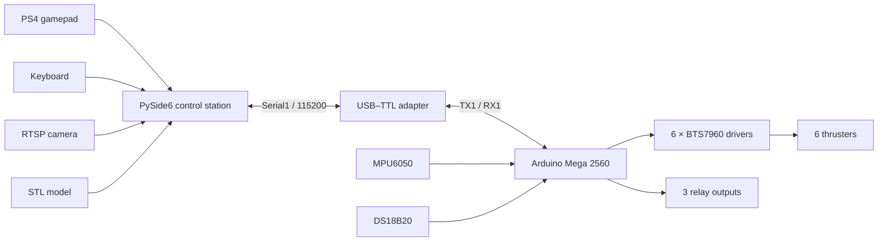

<div align="center">



<br />

# ROV Control Station

**A mission-control desktop application for a six-thruster remotely operated underwater vehicle.**

*PS4 control · Independent motor validation · Serial1 firmware · RTSP camera · 3D model · Live sensors*

<br />

[](https://www.python.org/)
[](https://doc.qt.io/qtforpython-6/)
[](https://www.arduino.cc/)
[](#communication-protocol)

[](#testing--project-status)
[](#thruster-map)
[](#quick-start)
[](https://github.com/Muhammad-296)

**[Features](#capabilities)** · **[Get started](#quick-start)** · **[Architecture](docs/ARCHITECTURE.md)** · **[Engineering handbook](docs/ENGINEERING_GUIDE.md)** · **[Hardware validation](docs/HARDWARE_VALIDATION.md)** · **[Troubleshooting](docs/TROUBLESHOOTING.md)**

</div>

---

## Mission overview

ROV Control Station brings the operator interface, Arduino Mega 2560 firmware, six BTS7960 thruster drivers, sensor data, camera streaming, and motor verification into one coordinated system. The desktop controller is built with **Python + PySide6**; real-time commands are handled by **Arduino Serial1 at 115200 baud**.

> [!NOTE]
> **Hardware status:** The project owner reports that the system has been **tested with physical hardware**. Exact test conditions, acceptance criteria, duration, and underwater qualification have not been supplied. The software includes simulated protocol tests, but neither those tests nor the owner-reported hardware testing imply safety certification.

<div align="center">

<br />
<sub>Original animated project graphic — illustrative; not live sonar data or a GUI recording.</sub>
</div>

## Capabilities

| Module | What it delivers |
| :-- | :-- |
| 🎮 **Pilot controls** | PS4 gamepad and keyboard-driven ROV control with 5-degree-of-freedom thruster mixing |
| ⚙️ **Advanced motor testing** | Dedicated non-modal test window; momentary keys **1–6**, per-motor speed, inversion, and command acknowledgements |
| 📷 **Video feed** | RTSP preview, independent camera window, configurable stream profile/transport, fullscreen and snapshots |
| 🧭 **Attitude & telemetry** | MPU6050 IMU visualization, DS18B20 water temperature, commanded PWM feedback and CSV logging |
| 🧊 **3D model view** | STL viewer and simulated orientation/movement visualization; **not** underwater position tracking |
| 🛡️ **Safety controls** | Firmware-authoritative arm/disarm, latched E-STOP / FAILSAFE, mode separation, active motor-test watchdog |
| 🧰 **Developer tools** | Versioned serial protocol, Python protocol test, Windows installer/launcher and PyInstaller build scripts |

## System architecture



> The architecture diagram shows intended component connections, not proof of validated electrical wiring. Match the firmware pin map to your assembled system.

## Engineering resources & continuous integration

[](https://github.com/Muhammad-296/ROV-Control-Station/actions/workflows/python-checks.yml)
[](https://github.com/Muhammad-296/ROV-Control-Station/actions/workflows/arduino-compile.yml)

> Status badges report automated workflow results **after** GitHub Actions has run. Passing automation is not evidence of successful hardware operation.

| Resource | Description |
|:--|:--|
| [Architecture](docs/ARCHITECTURE.md) | Mermaid block, communications and safety state diagrams, editable in GitHub Markdown |
| [Engineering guide](docs/ENGINEERING_GUIDE.md) | Components, signal wiring, firmware and GUI responsibilities, calibration, operations |
| [Serial protocol](docs/PROTOCOL.md) | V5 messages, mode rules, acknowledgments and telemetry |
| [Hardware validation](docs/HARDWARE_VALIDATION.md) | Owner-reported testing with blank, reproducible acceptance records |
| [Troubleshooting](docs/TROUBLESHOOTING.md) | Connection, motor, telemetry, camera and build diagnostics |
| [CI guide](docs/CI_GUIDE.md) | What the Python and Arduino workflows verify—and what they cannot |

## Quick start

### 1 — Requirements

- **Windows + Python 3.12** for the documented GUI workflow.
- Arduino Mega 2560 and the matching **V5 firmware**.
- Six BTS7960 motor drivers and wired thrusters for hardware operation.
- Serial1 USB–TTL adapter, compatible signal levels, shared ground, and a **separate physical motor power disconnect**.
- Optional PS4 controller, RTSP camera, MPU6050, DS18B20, and STL asset.

### 2 — Install & launch the desktop GUI

Run PowerShell in the repository root:

```powershell
py -3.12 -m venv .venv
.\.venv\Scripts\python.exe -m pip install --upgrade pip
.\.venv\Scripts\python.exe -m pip install -r requirements.txt
.\.venv\Scripts\python.exe ROV_Control_Station_Integrated.py
```

Alternatively, use `INSTALL_WINDOWS.ps1` followed by `RUN_GUI.bat`. A convenience Windows launcher (`START_ROV_WINDOWS.bat`) is also available.

> [!TIP]
> Keep the build environment **PySide6-only**. Installing PyQt6 into the same virtual environment can cause PyInstaller to abort due to competing Qt bindings.

### 3 — Flash matching Arduino firmware

1. Install **OneWire** and **DallasTemperature** in Arduino IDE; `Wire` is included with the Arduino platform.
2. Open [`ROV_Mega_Integrated/ROV_Mega_Integrated.ino`](ROV_Mega_Integrated/ROV_Mega_Integrated.ino).
3. Select **Arduino Mega or Mega 2560** and upload via the Mega's **programming USB** with motor load power disconnected.
4. Connect the USB–TTL adapter to **Serial1**, and choose its COM port in the GUI at **115200 baud**.
5. Verify the GUI receives `SYS:HELLO,5,ROV_MEGA6` before attempting to arm.

**GUI V5 and firmware V5 must be used together.** Previous protocol versions are not interchangeable.

### 4 — Build the Windows executable (optional)

Use `BUILD_EXE.ps1` after installing dependencies, or inspect `BUILD_ROV_EXE.bat` for its build workflow. PyInstaller output is placed under `dist/` when successful. A prebuilt `.exe` is **not included** in this source repository. Local executable builds should be verified on the destination Windows system.

## Hardware & wiring

### Thruster map

| Thruster | Position | RPWM | LPWM | R_EN | L_EN |
| :-- | :-- | --: | --: | --: | --: |
| **M0** | Front left | `2` | `3` | `23` | `25` |
| **M1** | Front right | `4` | `5` | `27` | `29` |
| **M2** | Rear left | `6` | `7` | `31` | `33` |
| **M3** | Rear right | `8` | `9` | `35` | `37` |
| **M4** | Vertical left | `10` | `11` | `39` | `41` |
| **M5** | Vertical right | `12` | `13` | `43` | `45` |

These are the **V5 firmware mappings**, not a guarantee of your real-world motor orientation. Confirm polarity and position against the physical assembly.

### Peripherals

| Peripheral | Mega 2560 connection | Notes |
| :-- | :-- | :-- |
| CP2102/USB–TTL adapter | TXD → `D19/RX1`; RXD ← `D18/TX1`; GND ↔ GND | Level-shift/protect adapter RX if it is not 5 V tolerant |
| MPU6050 | SDA `D20`, SCL `D21` | I²C |
| DS18B20 | Data `A15` | 4.7 kΩ pull-up to 5 V (per supplied design) |
| Relay channels | `D17`, `D16`, `D15` | Check active polarity and safe de-energized state |

**Never power the motor drivers from the Arduino signal pins.** Supply motor power independently and ensure appropriate power distribution, fusing, wire sizing, and grounding.

## Motor Test Station

The V5 release includes an **independent, non-modal Motor Test Station**, sharing the dashboard's verified COM connection. It isolates direct motor tests from normal drive controls.

| Action | Input |
| :-- | :-- |
| Select a motor | Hold **`1`–`6`** to command M0–M5 respectively |
| Stop selected motor | Release its key or on-screen hold button |
| Stop and disarm | **Space** |
| Latched emergency stop | **Esc** |
| Adjust motor power | Per-motor slider **5–60%**, common slider |
| Reverse direction | Reverse option or saved per-motor inversion |

**Typical procedure:** secure the ROV, remove propellers, verify the physical E-STOP, confirm firmware handshake, select Motor Test while **disarmed**, open the test window, explicitly **arm**, and test one motor briefly at low power. Closing or unfocusing the test station triggers stop behavior, and closing it disarms.

Safeguards in this mode include **single-motor command enforcement**, an active-test **225 ms packet watchdog**, an **8-second continuous-test limit**, and `MT:ACK` tracking. These limits are software/firmware defenses, not physical measurements or a substitute for emergency power isolation.

## Communication protocol

Text-based Serial1, **115200 baud**, newline-delimited, **protocol V5**.

| PC → firmware | Expected reply or action |
| :-- | :-- |
| `SYS,HELLO,5` | `SYS:HELLO,5,ROV_MEGA6` |
| `PING` | `PONG` (connectivity only) |
| `SYS,MODE,DRIVE` | Set DRIVE when disarmed |
| `SYS,MODE,INDIVIDUAL` | Set test mode when disarmed |
| `SYS,ARM` / `SYS,DISARM` | Request an authorized arm / disarm |
| `MT,1,0,15` | Request motor M0 at +15%; expect `MT:ACK,1,0,15` |
| `MT,2,-1,0` | Request immediate zero motor-test outputs |
| `SYS,ESTOP` / `SYS,RESET` | Latch stop / explicitly clear the latch when permitted |
| `V 20 0 0 0 0` | Example drive packet (DRIVE mode only) |

> [!IMPORTANT]
> An ACK reports **firmware command acceptance**, not physical RPM or thrust. PWM telemetry indicates commanded output, not measured electrical or mechanical feedback.

## Project layout

```text
ROV-Control-Station/
├── README.md                            # Project homepage
├── assets/
│   ├── rov-banner.svg                   # Designed GitHub banner
│   └── rov-sonar.gif                    # Original animated visual
├── ROV_Control_Station_Integrated.py    # PySide6 desktop application
├── ROV_Mega_Integrated/
│   └── ROV_Mega_Integrated.ino          # Matching Mega firmware V5
├── models/
│   └── ROV Assembly_Fully.STL          # 3D model
├── docs/
│   ├── CHANGES_V3.md
│   ├── CHANGES_V4.md
│   └── CHANGES_V5.md
├── requirements.txt
├── test_protocol.py                    # Synthetic protocol checks
├── INSTALL_WINDOWS.ps1                 # Python dependency setup
├── RUN_GUI.bat                          # Windows Python launcher
├── BUILD_EXE.ps1                        # PyInstaller build helper
├── BUILD_ROV_EXE.bat
├── START_ROV_WINDOWS.bat
├── START_ROV_MAC.command                # Optional; not independently verified
└── .gitignore
```

## Testing & project status

| Area | Current status |
| :-- | :-- |
| **Physical hardware operation** | **Tested — as confirmed by the project owner** |
| **Desktop Python syntax** | Previously checked with `py_compile` |
| **Protocol/state behavior** | Synthetic tests included in the source package |
| **Specific underwater endurance, waterproofing & performance** | Not documented in this repository |
| **Independent safety certification** | Not claimed |

Run the included software checks:

```powershell
py -3.12 -m py_compile ROV_Control_Station_Integrated.py
py -3.12 test_protocol.py
```

Hardware evidence (photos, videos, test logs, acceptance metrics) can be added later to document the owner's reported testing. No such evidence is implied by this README.

## Safety notice

> [!CAUTION]
> ROV thrusters and high-current motor drives can injure people or damage equipment. **Remove propellers for bench tests**, secure the assembly, use a current-limited supply where practical, install an **independent hardwired power cutoff**, check the driver power wiring and ground references, and confirm relay polarity. **Software E-STOP does not physically isolate motor power**, and zero PWM does not guarantee immediate mechanical stop. Perform separate waterproofing and electrical safety assessments before underwater operation.

## Release history

| Version | Highlight | Details |
| :-- | :-- | :-- |
| **V3** | Independent motor mode, mode handshake | [Changelog](docs/CHANGES_V3.md) |
| **V4** | Dedicated keyboard motor-test mode | [Changelog](docs/CHANGES_V4.md) |
| **V5** | Separate Motor Test Station, ACKs and watchdog | [Changelog](docs/CHANGES_V5.md) |

## Credits & licensing

**Maintainer:** [Muhammad-296](https://github.com/Muhammad-296) · **Project:** ROV Control Station · **Stack:** Python / PySide6 / Arduino / VTK / OpenCV / pygame.

The GUI source includes attribution for a DualShock 4 photograph by **ITEagle Europe / Sebastiaan Broekhoven**, licensed **CC BY-SA 4.0**; refer to the GUI source header for the original link and requirements.

**Project license:** No repository-wide license has been declared. Unless the owner adds one, this repository should not be treated as granting open-source reuse rights.

<div align="center">

---

**ENGINEERED FOR OBSERVABILITY · BUILT FOR CONTROL · TESTED ON HARDWARE (OWNER REPORTED)**

[Back to top ↑](#rov-control-station)

</div>
