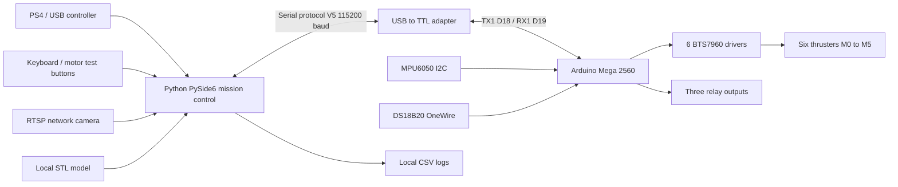
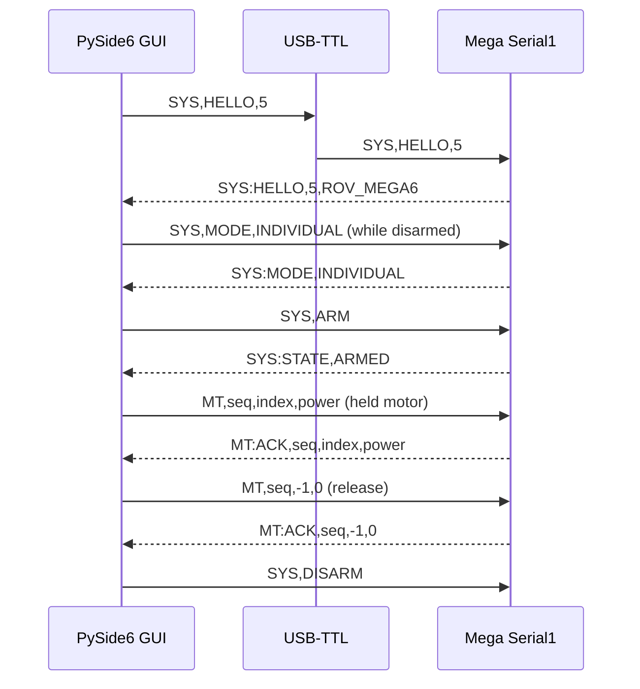
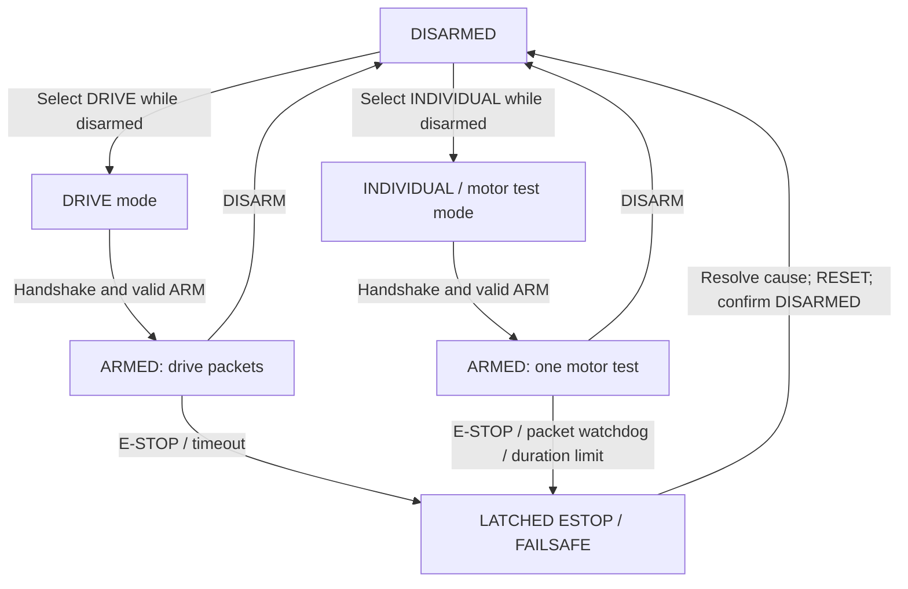

# System architecture — ROV Control Station V5

All Mermaid diagrams below are rendered by GitHub and can be edited as text. They describe the implementation and intended wiring, not an independently verified electrical schematic.

## 1. System block diagram

## 2. Serial data and control

## 3. Software control modes

Mode and safety-state transitions are simplified for readability; the firmware source is authoritative. Neither GUI E-STOP nor a firmware timeout replaces a **hardwired motor-power isolation switch**.

## 4. Physical topology

- Arduino Mega **D18 TX1** to adapter RXD (level protection where required), **D19 RX1** from adapter TXD, and common GND.
- PWM and enable connections: see [Engineering guide](ENGINEERING_GUIDE.md#motor-driver-pin-map).
- MPU6050: SDA D20, SCL D21. DS18B20: data A15 with 4.7 kΩ pull-up.
- RTSP camera communicates with PC over the camera's network path, *not* Arduino Serial1.
- 3D STL visualization is illustrative/simulated, not measured pose or subsea navigation.
